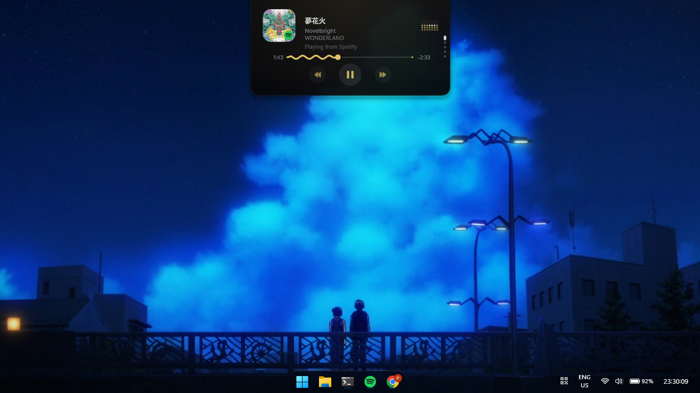
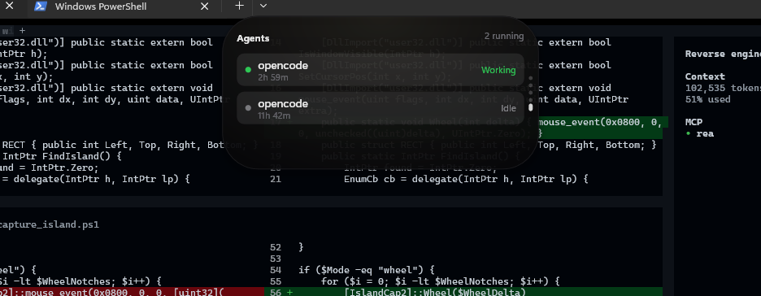

# Dynamic Island for Windows — Notch

A living, breathing **macOS-style Dynamic Island pill for Windows**, published as a plain
**standalone `.exe` — no Windhawk required**. It reacts to your media, clipboard,
notifications, battery, camera/mic, and coding agents, renders natively with
Direct2D at up to 360–500 FPS, and lives above every window — or disappears
entirely behind your clicks.

Based on the Windhawk mod, rebuilt here as a
self-contained executable with a built-in settings dashboard, a persistent
**Ctrl+B click-through mode**, and automatic **run-on-startup**.

<p align="center">
  
</p>

---

## Download & run

1. Grab **`DynamicIsland-v1.4.0-x64.zip`** from the [**Releases**](https://github.com/preetbiswas12/Notch/releases) page
   (or download `DynamicIsland.exe` + `settings.html` + the `public/` folder individually).
2. Unzip anywhere — e.g. `Documents\DynamicIsland`. Everything stays in that folder.
3. Double-click **`DynamicIsland.exe`**. Done.

On first run the exe creates `island.ini` (every setting, with defaults) and
registers a **per-user Windows startup entry**, so the island automatically
relaunches after every reboot — no admin rights, no installer. The entry is
rewritten on every launch (it follows the exe if you move the folder) and is
removed cleanly when you turn the setting off.

| | |
|---|---|
| **Quit** | `DynamicIsland.exe --quit` or **Ctrl+Alt+Shift+X** |
| **Second launch** | Does nothing (single instance) |
| **Debug log** | Start with `--log` (writes `island.log`) |
| **Custom config** | Env `DYNAMIC_ISLAND_INI=<path>` |
| **Portable data dir** | Env `DYNAMIC_ISLAND_DIR=<dir>` (otherwise `%LOCALAPPDATA%\DynamicIsland` when the folder is read-only) |

## Features

**Media & lyrics** — live album art, playback controls, four audio-spectrum
styles (Classic Bars, Peak Matrix, Plasma Thread, Pulse Orb), real-time synced
**live lyrics** (on the collapsed pill too), lyrics sync offset (with a separate
offset for Bluetooth), wavy/squiggle progress bars.

**Dashboards** — scroll (or click the dots) between: Media · Calendar ·
Weather (wttr.in) · Hardware monitor (CPU/RAM/GPU/disk/network) · Game overlay
(FPS/CPU/GPU/RAM) · Idle clock & battery · File Tray (drag files onto the pill
to park them, drag them back out) · **Agents**.

**Coding Agents tab** — a violet pill dot + agent name while a coding agent
runs (OpenCode, Claude Code, Codex, Gemini CLI, Aider, Kilo Code, ChatGPT, VS
Code, Cursor, Windsurf, Copilot, … — fully editable list), with a dashboard tab
listing every detected agent, its state, host terminal and uptime, plus its
logo from the `public/` folder. Clicking a row jumps to that terminal.
*Inspired by [Agent Notch](https://github.com/KurianJose7586/notch).*

**System & privacy** — pulsing orange mic dot and green camera dot, battery +
charging state, high-res clipboard previews and notification icons, volume and
brightness overlays, Quick Lookup dictionary/Wikipedia search
(**Ctrl+Alt+Space**).

**Look & feel** — 8 curated themes (Obsidian, Graphite, Slate, Nord, Evergreen,
Espresso, Plum, light Porcelain) + custom hex colors with alpha, real Windows
**blur / acrylic** backdrops, album-art-derived contour borders, shape styles
(pill / Windows 11 / notch), position & offset on any monitor (or follow the
mouse), 80–250% size scale, 12 UI languages, 30–500 FPS refresh-rate control,
and per-element animation speeds.

<p align="center">
  
</p>

## Keyboard shortcuts

| Shortcut | Action | Notes |
|---|---|---|
| **Ctrl+B** | Toggle **click-through mode** | Passes hover/clicks through to whatever is under the pill — even expanded — and fades it to 30%. Press again to restore. See the demo below. |
| **Ctrl + hover** | Momentary click-through | Same as above, only while held. |
| **Ctrl+Alt+D** | Hide / show the island | Instant, zero CPU while hidden. |
| **Ctrl+Alt+Space** | Quick Lookup search | Requires `Modules.QuickLookup`; results from Wiktionary/Wikipedia. |
| **Scroll** | Next / previous dashboard tab | |
| **Right-click** | Island menu | Themes, lyrics sync, pin, Open Settings. |
| **Ctrl+Alt+Shift+X** | Quit | |

Every hotkey is **remappable** in the settings page under **Shortcuts &
Hotkeys** (enable/disable, modifier combos, key) and applies live after save.

<details>
<summary><b>Ctrl+B click-through demo</b></summary>

<p align="center">
  <video src="assets/video.mp4" controls width="640" style="border-radius:12px"></video>
</p>

Press **Ctrl+B** to toggle click-through mode — the island becomes transparent to
mouse clicks (even while expanded) so you can click through to whatever's behind
it. Press again to restore normal interaction.

</details>

## Settings — one-click save

Right-click the island → **Open Settings**. The exe itself serves the settings
page over a loopback-only HTTP server (`127.0.0.1:<random port>`, nothing
external), so the page can write `island.ini` **directly on Save** — every
section reloads into the island live (~1 s), no restart, no manual file
shuffling.

Every single mod setting is exposed: appearance & position, behavior
(always-on-top, expand-on-hover, auto-hide, **run on startup**), animations,
modules, themes, indicators, and shortcuts. You can also edit `island.ini`
by hand (UTF-16 LE) — saves from the page or file changes are picked up
immediately.

## Build from source

Requirements: Windows 10/11 and .

```powershell
powershell -ExecutionPolicy Bypass -File standalone\build.ps1
```

produces `standalone\out\DynamicIsland.exe` (~1.9 MB, x64, fully static C++
runtime, imports only system DLLs). After editing settings in the mod's YAML
block, regenerate the baked-in defaults:

```powershell
powershell -ExecutionPolicy Bypass -File standalone\generate_defaults.ps1
```

Quit a running island first (`--quit`) — the linker can't overwrite a locked
exe. Build/link details live in the comments of `standalone\build.ps1`.

## Repository layout

```
mod/dynamic-island-for-windows.wh.cpp   the mod source (original + standalone bootstrap)
standalone/                             the exe host: entry point, Wh_* API shim,
                                        generated defaults, settings dashboard, build script
public/                                 agent logos shown on the Agents tab (kept next to the exe)
assets/                                 screenshots
```

## Credits & license

- **Standalone build, settings dashboard, click-through mode, startup integration:**
  [Preet Biswas](https://github.com/preetbiswas12).
- **Agents tab** inspired by [Agent Notch](https://github.com/KurianJose7586/notch).

Released under the [MIT License](LICENSE).
